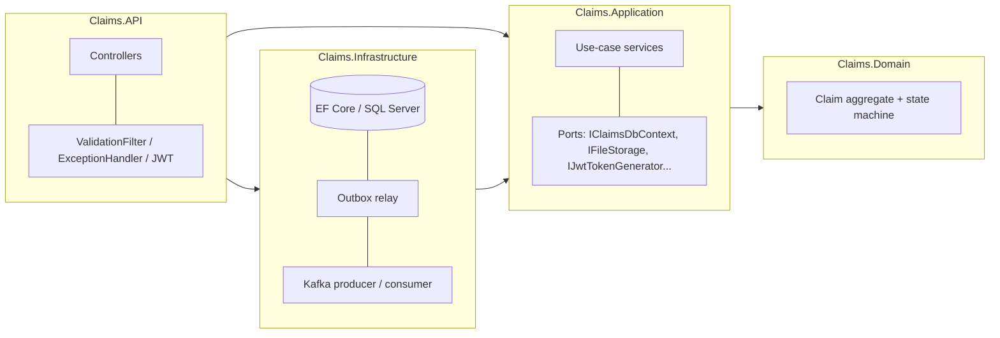
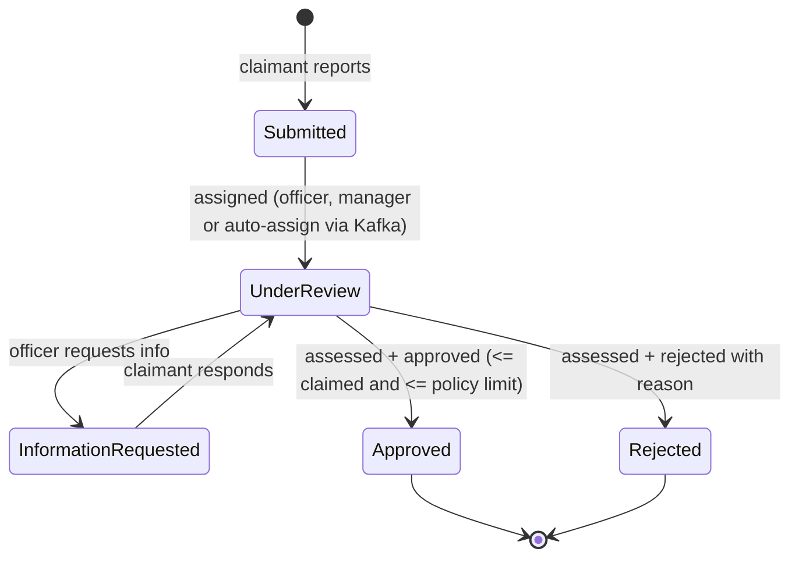
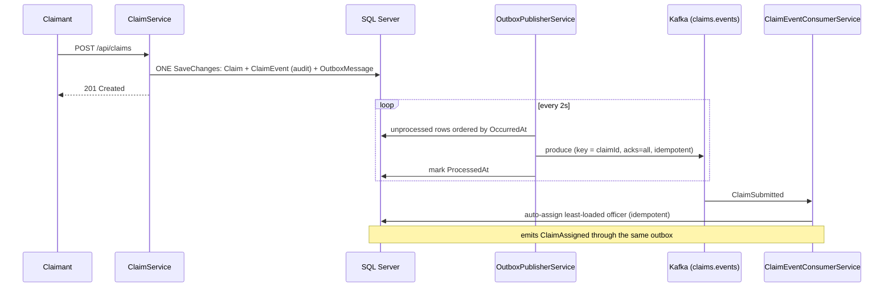

# Architecture

> Status: the code has **not been compiled or executed** in the environment that generated it (no .NET SDK,
> Docker or network was available). See the README's "Verification status" section.

## 1. Layering (Clean Architecture)

Dependencies point inwards. The Domain has no package references. The Application layer depends on the
EF Core *abstractions* (`DbSet`, `IQueryable`) through `IClaimsDbContext` rather than hand-rolled
repositories, a deliberate trade-off to avoid a pass-through repository layer.

## 2. Claim lifecycle

Enforced in `Claim.TransitionTo` and covered by a theory test over the transition table.

## 3. Reliable event publishing (Transactional Outbox)

* Aggregates raise `DomainEvent`s; `ClaimsDbContext.SaveChanges` turns them into `OutboxMessage` rows
  inside the same database transaction, so a state change can never exist without its event, or vice versa.
* Delivery is **at-least-once**. The consumer's auto-assignment is idempotent (skips already-assigned claims).
* Key = claim id, so all events of one claim are ordered within a partition.
* A failing message halts the batch (to preserve order) and is parked after 10 attempts (visible in the table).

## 4. Security

* JWT (HMAC-SHA256), 60 min expiry, role claim. PBKDF2-SHA512 (210k iterations) password hashes.
* Role policies on controllers **and** ownership/assignment checks in services (defence in depth).
* Claimants get 404 (not 403) for other people's claims; internal assessment notes are never returned to claimants.
* Uploads: extension allow-list, 10 MB cap, magic-byte check, server-generated storage keys, path-traversal guard.
* Login endpoints rate-limited; uniform error for bad credentials (no account enumeration).

## 5. Data model

Claim (aggregate root) owns Documents, Assessments, Assignments, InformationRequests, ClaimEvents and one Decision.
Claimants, Policies and Users are separate aggregates referenced by id. `Claim.Version` is an optimistic
concurrency token. Enums are stored as strings. See `DOMAIN-MODEL.md`.
